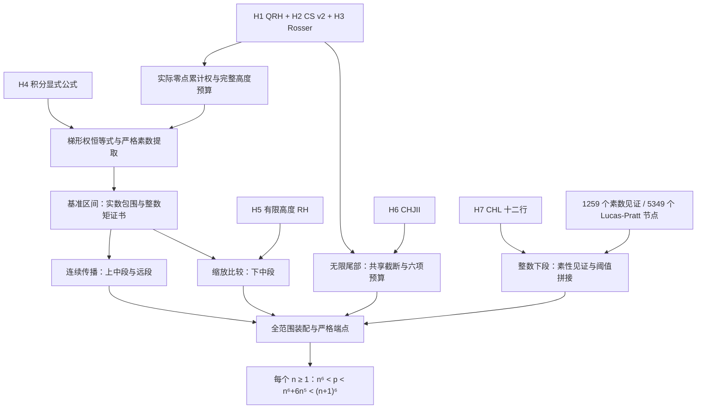

# 从七项输入到相邻六次幂素数的证明结构

这份导读与[当前主论文](../../paper/current/main.pdf)使用同一组章节和声明标记。逐项文件链接由[生成的对应表](theorem_map.md)提供，[JSON](reading_map.json)记录源码散列。这里的图表达数学主干；全部实际传递依赖见[最终 Lean 审计](../../audit/builds/final-20261106/final_dependencies.txt)。



## 分段使用的输入

| 数学部分 | 域 | 外部输入 | 主要 Lean 入口 |
|---|---|---|---|
| 整数下段 | `1≤n≤1242317999994` | H7；有限见证在库内证明 | `LowerRange` |
| 下中段 | `167≤log x≤178.75` | H1、H2、H3、H4、H5 | `M3LowerResult` |
| 上中段 | `178.75≤log x≤400` | H1、H2、H3、H4 | `M3MiddleUpper` |
| 远段 | `400≤log x≤700` | H1、H2、H3、H4 | `M3FarUpper` |
| 无限尾部 | `log x≥700` | H1、H2、H3、H6 | `TailFromInputs` |
| 所有正整数 | 所有 `n≥1` | 七项输入的并集 | `FinalResult` |

## 怎样审查一个步骤

先读纸面命题的定义域、精确不等式和证明，再沿对应表打开 Lean 陈述。数值部分继续检查候选数据如何被转换为已证明的有理包围和整数不等式。最后检查该声明是否实际进入最终定理的依赖链，而不是仅存在于仓库中。

生成器命令为：

```sh
python code/build_reading_map.py
python code/build_reading_map.py --check
```

它检查声明名、文件、TeX 交叉引用和书目键，并生成固定散列的阅读映射；它不自动证明人类正文与 Lean 命题语义等价。相应交叉审阅报告在 `audit/` 单列。完整项目源码保留在 `lean/`，本次未为整理目录而更改其命名空间或证明内容。
